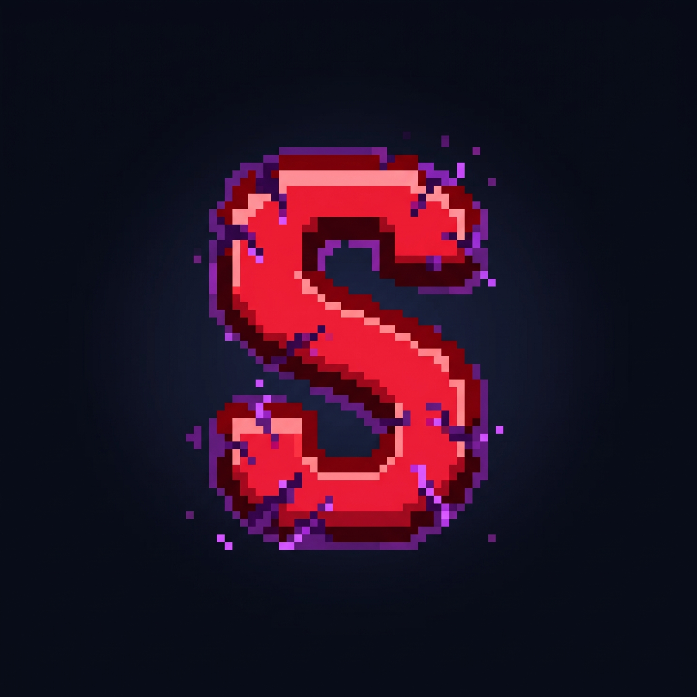

# Sanguis & Miasma

<p align="center">
  
</p>

<p align="center">
  <strong>Um jogo de ação e plataforma 2D em pixel art gótica com foco em combate metódico, progressão e atmosfera sombria.</strong>
</p>

<p align="center">
  
  
  
</p>

---

## Sobre o Jogo

Em **Sanguis & Miasma**, você assume o controle de um guerreiro solitário explorando as ruínas decadentes de um antigo reino castigado por uma corrupção fétida. Caminhe por salões decrépitos, capelas abandonadas e passarelas escuras para purificar o castelo e destronar o tirano que sucumbiu ao miasma.

O jogo foi projetado seguindo princípios clássicos de **Game Design**, balanceando momentos de introdução de habilidades, combate desafiador, plataformas, pausas estratégicas e uma batalha contra chefe multifásica.

---

## Mecânicas e Habilidades

- **Sistema de Vida e Escudo**: Comece com 3 corações e 2 cargas de escudo. Bloqueie ataques inimigos e projéteis com precisão para atordoar os adversários.
- **Ataque e Arremesso de Espada**: Ataque corpo a corpo ágil ou lance sua lâmina à distância (capaz de atravessar grades e acionar cristais/interruptores). Ao arremessar, é necessário buscá-la para voltar a golpear.
- **Caixas Destrutíveis e Economia**: Caixas e escombros escondem corações de cura e moedas douradas.
- **Loja do Mercador**: Entre os combates, utilize as moedas conquistadas para aprimorar Dano da Lâmina, Vigor Máximo (Vida), Resistência do Escudo ou comprar Elixires de Cura.
- **Perigo Real (Permadeath)**: Morrer reinicia a tentativa desde o Nível 1, exigindo atenção, domínio dos controles e paciência.

---

## Inimigos e Desafios

- **Ratos da Peste**: Inimigos velozes que saltam em sua direção quando em alerta.
- **Morcegos do Miasma**: Voam fora do alcance terrestre e disparam guspes venenosos roxos que só podem ser bloqueados pelo escudo.
- **Guardas Ogros**: Brutais e resistentes, anunciam seus golpes e avançam com dashes ferozes.
- **Tirano Corrompido**:
  - Arremessa seu machado pesado à distância e precisa buscá-lo na arena.
  - Recua para os balcões e convoca 3 hordas de servos corrompidos antes do confronto final.
  - Diálogos narrativos antes do combate.

---

## Controles

| Ação | Teclado | Mouse / Alternativo |
| :--- | :--- | :--- |
| **Mover** | `A` / `D` ou `Setas` | — |
| **Pular** | `W` / `Espaço` | — |
| **Ataque Físico** | `J` / `Z` | `Botão Esquerdo` |
| **Defender com Escudo** | `K` / `X` / `Shift` | `Botão Direito` |
| **Arremessar Espada** | `L` / `C` / `Q` | — |
| **Interagir (Loja)** | `E` / `F` | — |
| **Pausar / Menu** | `ESC` / `P` | — |

---

## Tecnologias Utilizadas

- **Engine**: [Godot Engine 4.x](https://godotengine.org/) (Forward+)
- **Linguagem**: GDScript
- **Arte**: Pixel art com shader dinâmico de desfoque (pause blur), pós-processamento de corrupção e interface com 9-slice stone cards.
- **Áudio**: Efeitos sonoros sintetizados nativamente em tempo real (`AudioStreamGenerator`) e trilhas sonoras dedicadas para exploração e combate contra o Boss.

---

## Como Executar

### Via Código-Fonte (Godot Editor)
1. Instale o **Godot Engine 4.2+** (recomendado Godot 4.7+).
2. Clone o repositório:
   ```bash
   git clone https://github.com/IagoCrs/Sanguis-Miasma.git
   ```
3. Abra o Godot e importe o projeto selecionando o arquivo `project.godot`.
4. Pressione `F5` para jogar.

### Via Executável (Windows)
1. No Godot, abra **Projeto -> Exportar...**
2. Com os modelos instalados, clique em **Exportar Projeto** para gerar o `.exe`.

